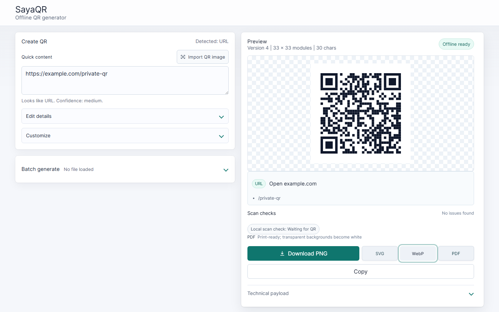

  
  <h1>SayaQR</h1>
  
<strong>Private QR codes, made entirely in your browser.</strong>

  
Generated locally. No tracking. No upload.

  

    <a href="https://subtlesayak.github.io/SayaQR/"><strong>Open SayaQR</strong></a>
    ·
    <a href="https://github.com/subtlesayak/SayaQR/releases/latest">Latest release</a>
    ·
    <a href="./CHANGELOG.md">Changelog</a>
  

  

    
    
    
    
  

  

SayaQR v2.0.0 · content → inspect → download

## Why SayaQR

| | |
| --- | --- |
| **Private by default** | QR content, passwords, contacts, payments, images, and batch files stay in your browser. |
| **Works offline** | Installable PWA with a locally cached app shell and no CDN dependency. |
| **Easy first, powerful later** | Paste content and download immediately; structured fields and design controls remain collapsed until needed. |
| **Open and inspectable** | Strict TypeScript, an MIT project license, and Nayuki's MIT-licensed QR encoder. |

## From content to QR

1. **Paste or type** content. SayaQR detects the QR type automatically.
2. **Inspect and style** the live QR while local scan checks flag risky choices.
3. **Download, copy, or share** without sending the payload anywhere.

## What you can create

| QR type | Useful for | QR type | Useful for |
| --- | --- | --- | --- |
| **Plain text** | Notes, labels, serials | **URL** | Websites and deep links |
| **Wi-Fi** | Network credentials | **Email** | Address, subject, and body |
| **SMS** | Number and prepared message | **Phone** | Tap-to-call links |
| **vCard** | Shareable contact details | **UPI** | Indian payment requests |
| **Event** | Calendar invitations | **Geo** | Coordinates and map labels |

## Built for real use

| Area | Included |
| --- | --- |
| **Intent-aware input** | Automatic type detection, structured field editing, human-readable previews, and content-aware filenames. |
| **Compact encoding** | Automatic numeric/alphanumeric/UTF-8 segmentation can reduce mixed-content QR grids while preserving the payload and selected error correction. The original encoder remains a fallback, and optimized output never uses a larger grid. |
| **Design controls** | Independent module, finder, and background colors, transparency, quiet zone, module size, rounded modules, finder style, center logos with optional backing/stroke, and collapsed advanced module styles. |
| **Scan safety** | Contrast, quiet-zone, logo-size, and payload-density warnings plus local blur, size, contrast, and rotation simulations. |
| **Flexible output** | Inline PNG, SVG, WebP, WYSIWYG PDF, STL, 3MF, and OBJ coaster downloads; image copy and native sharing when supported. |
| **Local QR import** | Decode QR screenshots through file selection, drag and drop, or paste without uploading the image. |
| **Batch generation** | CSV/TXT drag and drop, column suggestions, validation, deterministic filenames, cancellation, ZIP export, and error reports. |
| **Opt-in design memory** | Save visual preferences under `sayaqr:design:v1`; content and uploaded files are never persisted. |
| **Offline PWA** | Installable app, native share target, relative paths for GitHub Pages, and locally bundled dependencies. |

Imported Wi-Fi, contact, payment, calendar, and other structured QR strings keep their original payload until you edit the supported detail fields. Wi-Fi network names and passwords preserve significant spaces. TXT batch files use one literal payload per line; commas and quotes are content, not separators.

Raised 3D exports use closed base, QR, and finder material parts in one 3MF assembly. STL exports contain only the outer solid shell. Engraved mode is a through-hole stencil with sparse 0.4 mm support bridges that keep enclosed regions attached. Place the stencil on a contrasting surface and test scanning before printing. The 3D preview uses the exported mesh and its actual dimensions; OBJ retains fine coordinate precision for editing.

Installed PWA shares use a service-worker-intercepted POST and a one-time in-memory handoff. Shared payloads are never sent to the hosting server or written to Cache Storage. The offline badge becomes ready only after the worker confirms a fully cached app shell. Updating removes older SayaQR caches, including legacy query-bearing cache entries.

## Privacy by design

SayaQR has no backend and makes no content API calls. QR payloads, Wi-Fi passwords, UPI details, contacts, locations, events, imported images, custom logos, and batch rows remain on the device.

Advanced module styles include Classic, Module dots, Pixel blocks, Soft squares, Neon glow, Split-color finders, and Sticker border. Stylized QR codes can scan less reliably than Classic, so SayaQR shows an extra scan warning when one is selected.

| Data | Behavior |
| --- | --- |
| QR content and structured fields | Used in memory for generation; never transmitted or persisted. |
| Imported QR images and custom logos | Decoded or rasterized locally; never uploaded. |
| Design preferences | Stored in localStorage only after **Use this design next time** is enabled. |
| Native share text | Uses a generic description and never includes the encoded payload. |

There is no analytics, advertising, account system, cloud storage, URL shortener, or redirect service.

## Exports that match the preview

| Format | Best for |
| --- | --- |
| **PNG** | Everyday sharing and documents |
| **SVG** | Design tools and scalable printing |
| **WebP** | Compact web images |
| **PDF** | Print-ready output |
| **STL** | Single-material 3D-printable QR coaster geometry |
| **3MF** | Color/material-aware 3D-printable QR coaster |
| **OBJ** | Blender import with a companion MTL material file |

SVG, PNG, WebP, PDF, clipboard copy, and native sharing all use the styled preview SVG as their canonical source. Colors, background, rounded modules, finder style, center logo, logo backing, quiet zone, and proportions stay consistent across those 2D formats.

PDF export embeds a lossless PNG at a minimum of 1600 × 1600 pixels. Transparent backgrounds become white for PDF because printed paper has a background.

3D exports generate a configurable square cup-coaster model locally from the same QR payload and error-correction level. The advanced 3D settings support 90, 95, 100, and 105 mm coaster sizes plus base and raised-module heights. SayaQR reports small-cell and low-height print risks before export. STL is geometry-only for broad slicer compatibility. 3MF separates the base, QR modules, and finder modules so Bambu Studio can assign materials. OBJ downloads as a ZIP containing named Blender groups plus `.obj` and `.mtl` files; its coordinates are encoded in metres so Blender's default OBJ importer produces the intended millimetre size.
3D exports include a local `README.txt` with dimensions, profile, material behavior, and import notes. Profiles apply height, relief, color strategy, and bottom-inlay settings together. The manual filament-swap profile has no colored bottom inlay and uses two materials above/below the base boundary. Engraved mode is a through-hole stencil with support bridges, not a filled recess. The shared preview supports full rotation. Bevels and mounting holes are not currently implemented.

App updates wait for the **Update available** button; they never automatically reload a page containing unsaved QR content. Batch downloads snapshot their settings when generation starts, so later control changes cannot alter individual models inside the same ZIP.

3D geometry and topology checks run in a bundled local Web Worker, including offline. A newer preview cancels obsolete work; model downloads and batch generation can be cancelled. Coplanar mesh rectangles are merged with conforming boundary vertices to preserve closed edges. STL downloads use binary encoding; 3MF uses browser-native DEFLATE compression when available, with stored ZIP fallback. No model or QR content is sent to a server.

The collapsed 3D settings include nozzle diameter, layer height, and 2/3/4/6-layer base presets. Heights round upward to whole layers; bottom inlays leave at least one base layer above them. Thin two-layer bases carry a fragility warning. Stencil bridges target at least the nozzle width where the QR cell permits it; a warning flags cells too small to meet that target. These are model settings and checks, not a replacement for your slicer's printer profile.

### 3D regression fixtures

`pnpm test:fixtures` creates synthetic raised, thin, stencil, single-color, and two-color OBJ/STL/3MF fixtures in a temporary directory and prints that directory. To independently check their imports, run Blender in an isolated process:

~~~bash
blender --background --factory-startup --disable-autoexec --python-exit-code 1 --python scripts/verify-blender.py -- <fixture-directory>
~~~

The checker verifies OBJ/STL import dimensions, mesh closure, positive volumes, material regions, and 3MF ZIP integrity, XML parts, and assembly structure. Unit tests also intersect models with horizontal planes to check flush bottom colors, raised top occupancy, and through-holes. These checks do not claim Bambu Studio slicing or physical print validation.

Copy and Share appear only when the browser supports those capabilities. Installed PWAs can receive shared URLs or text; incoming share parameters are auto-detected locally and removed from browser history immediately.

> [!NOTE]
> Scan confidence is an advisory local simulation, not a guarantee. Always test styled or logo-heavy QR codes with the cameras and scanning apps your audience will use.

## Run locally

**Requirements:** Node.js 22+ and [pnpm](https://pnpm.io/).

~~~bash
# Install dependencies
pnpm install

# Start the development server
pnpm dev

# Run the test suite
pnpm test

# Build production assets
pnpm build

# Preview the production build
pnpm preview
~~~

The development server is available at `http://127.0.0.1:5173/` by default.

## Deployment

- **Live app:** [subtlesayak.github.io/SayaQR](https://subtlesayak.github.io/SayaQR/)
- **Latest release:** [github.com/subtlesayak/SayaQR/releases/latest](https://github.com/subtlesayak/SayaQR/releases/latest)
- **Deployment workflow:** [Deploy to GitHub Pages](https://github.com/subtlesayak/SayaQR/actions/workflows/deploy-pages.yml)

Pull requests run the test suite and production build. Every push to `main` rebuilds and deploys `dist/` to GitHub Pages, then creates the versioned GitHub release when its tag does not already exist.

SayaQR uses relative Vite paths, so the same production build can be hosted from a subpath on GitHub Pages or another static host. No server runtime is required.

## Contributing

Issues and pull requests are welcome. Please preserve the core product contract:

- browser-only and local-first
- no tracking, accounts, cloud storage, or content APIs
- advanced controls hidden until requested
- keyboard-accessible controls and mobile layouts without horizontal overflow
- tests and a production build before merge

## Credits and license

SayaQR is released under the [MIT License](./LICENSE).

- **QR encoding:** [Project Nayuki's QR Code generator](https://www.nayuki.io/page/qr-code-generator-library), vendored in `src/lib/nayuki-qrcodegen.ts` under the MIT License. The original copyright and permission notice are preserved.
- **QR decoding:** [jsQR](https://github.com/cozmo/jsQR), bundled locally under the Apache License 2.0.
- **Logo presets:** Local SVG path data from Material Design Icons, Simple Icons, and Wikimedia Commons where available. Brand names and marks remain the property of their respective owners.
- **Design inspiration:** [QRBTF](https://github.com/CPunisher/react-qrbtf) and [QRFrame](https://github.com/zhengkyl/qrframe) inspired the exploration of approachable QR styling. Their source code, UI, and assets are not copied into SayaQR.

The Nayuki encoder, jsQR decoder, logos, and all application dependencies are bundled locally. Generating or decoding a QR never requires a third-party request.

---

  Built by <a href="https://subtlesayak.github.io/"><strong>Subtle Sayak</strong></a>
  ·
  <a href="https://github.com/subtlesayak/SayaQR">GitHub</a>

